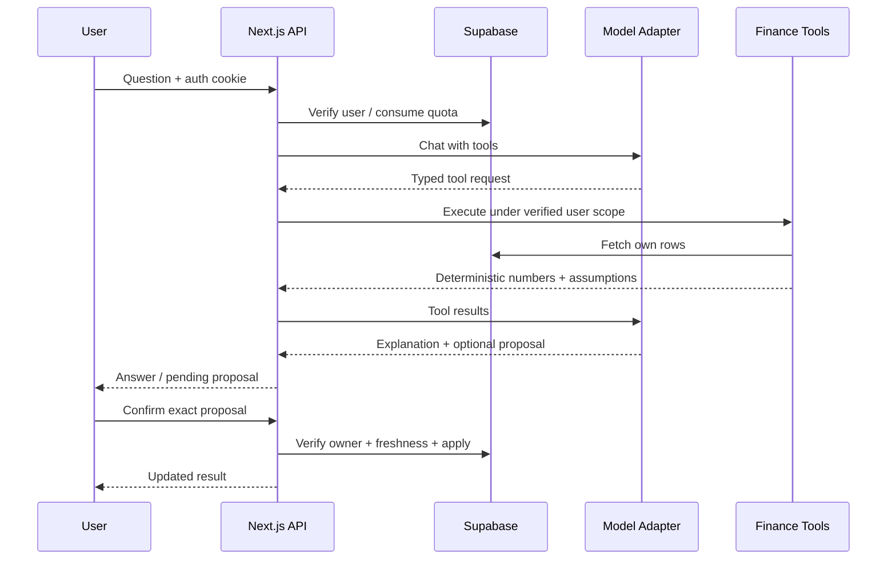
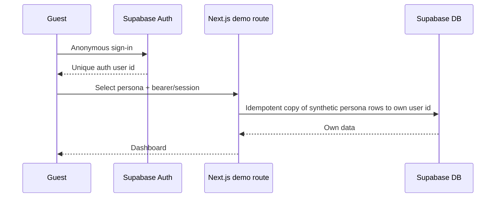

# FinPilot AI MVP — Technical Design

## Context and architecture
A single Next.js TypeScript app runs on AWS Amplify; Supabase Auth/PostgreSQL/storage is one shared project for local and deployed clients. AI Chat/Vision uses a server-side `AIProvider` adapter with user-selected Gemini/OpenRouter URL/model/key. See `docs/04-architecture.md` and `docs/07-ai-provider-adapter.md`.

## Modules
- `auth`: Supabase server/client auth, anonymous login, owner ID derivation, email/password login.
- `db`: typed owner-scoped repository; service admin only for narrow server operations.
- `finance`: pure current balance, recurring calendar, daily projection, buy-now/later comparison.
- `import`: CSV mapping/validation/duplicate preview/confirm and receipt editable draft.
- `ai`: capability-aware transport, allowlisted finance tools, bounded tool loop, proposed-write confirmation, daily quota.
- `ui`: five pages + entry/auth/onboarding, with Stitch reference.

## Data schema
Candidate SQL under `supabase/migrations/202611230001_finpilot_initial.sql`. RLS for owned profile/transactions/imports/recurrences/goals/conversations/messages. `ai_proposals` and `ai_usage_daily` are readable to owner but write only through verified server actor. `mock-data` files provide seed sources; never DB read-only fallback at runtime.

## Principal sequence: Chat + real tool + confirmation

## Principal sequence: guest demo

## Error/consistency decisions
- `bigint` VND internally, JSON decimal string API, no LLM math.
- Snapshot anchors actual balance; dates in Asia/Ho_Chi_Minh; recurring settled instance reconciliation.
- CSV preview/confirm and receipt draft/confirm are separate stages; idempotency keys mitigate repeat submissions.
- Quotas atomic and only guest limited at current agreed values; non-guest generic abuse safeguards still apply.
- Invalid provider config → explicit UI failure; no fake AI or mocked production outputs.

## Test design
Pure unit tests finance, integration RLS with distinct owner JWTs, E2E in guest persona and demo-account flows, provider contract tests with user-supplied credentials, and public Amplify smoke after authorized release. See AC-01–AC-18.

## Architecture constraints
No second Supabase DB, no automatic deploy/remote mutations, no background cleanup without approval, no real payments. Stitch exports are design reference, not source of truth for behavior. If SSR compatibility uncertain, verify AWS docs and choose supported Next.js version instead of improvising.
